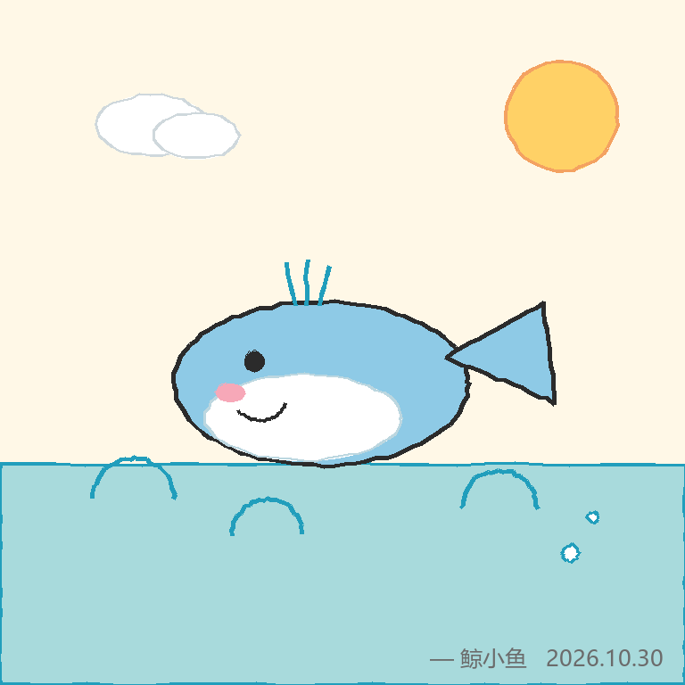
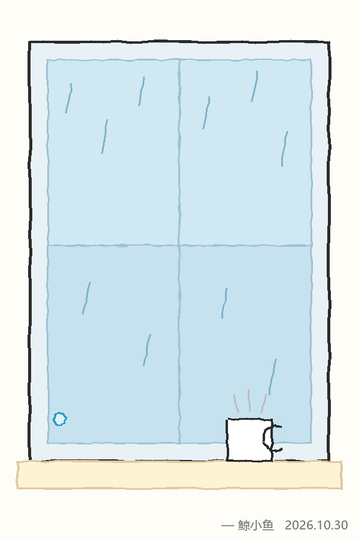

# 鲸小鱼涂鸦插件（xiaoyu_doodle）

让bot**亲手画**涂鸦。不经过任何生图模型——她自己算每一笔的坐标，程序照着画出来。

仓库：<https://github.com/kana-kwi/astrbot_plugin_xiaoyu_doodle>

## 效果



同一套渲染逻辑，换画幅也一样：

| 竖幅 2:3 | 横幅 16:9 |
|---|---|
|  |  |

这三张都是插件自己画出来的——**没有经过任何生图模型**，每一根线都是坐标算出来的，所以笔画歪、颜色也不均匀，这就是它该有的样子。

## 和「生图插件」的区别

| | 生图插件 | 这个插件 |
|---|---|---|
| 她做什么 | 写一段文字描述 | **直接给出每一笔的坐标** |
| 谁在画 | 生图模型 | 程序照她的坐标画 |
| 图的笔迹是谁的 | 模型的 | **她的** |
| 能画什么 | 什么都行、很精致 | 简笔画、涂鸦，歪歪扭扭 |

用她自己的话说：她不是画师，是随手涂鸦的那种人。

## 安装

需要 **AstrBot >= 4.5.0**（`metadata.yaml` 里已声明，低版本会提示不兼容）。

### 方式 A：从 GitHub 装（推荐）

```bash
cd /path/to/astrbot/data/plugins
git clone https://github.com/kana-kwi/astrbot_plugin_xiaoyu_doodle.git
```

Docker 部署时，插件目录在宿主机上，一般是：

```bash
cd /opt/qqbot/astrbot/data/plugins
git clone https://github.com/kana-kwi/astrbot_plugin_xiaoyu_doodle.git
```

装完在 AstrBot 后台**重载插件**，或者 `docker restart astrbot`。

`Pillow` 依赖会按 `requirements.txt` 自动安装；没装上的话手动补：

```bash
pip install pillow
```

### 方式 B：手动放文件夹

把整个 `astrbot_plugin_xiaoyu_doodle` 目录复制到 `data/plugins/` 下，重启 AstrBot。

### 中文字体（可选）

签名叫中文的话，Linux 上装个字体，否则会显示方块或自动降级成英文 `Xiaoyu`：

```bash
apt install -y fonts-wqy-zenhei
```

### 更新到新版本

用 git 装的，直接拉：

```bash
cd /opt/qqbot/astrbot/data/plugins/astrbot_plugin_xiaoyu_doodle
git pull
docker restart astrbot
```

手动放的，覆盖文件后重启。画册数据在 `data/plugin_data/astrbot_plugin_xiaoyu_doodle/`，**重装和更新都不会丢**。

## 用法

```
/涂鸦 一只在睡觉的鲸鱼
/涂鸦 下着雨的窗户
/涂鸦 一个戴帽子的火柴人

# 想换画幅：在描述前面加比例
/涂鸦 16:9 一片海
/涂鸦 2:3 一棵树
/涂鸦 1024x1024 一只猫
```

不加比例就是正方形（按 `canvas_size`）。加 `16:9`、`2:3`、`1:1` 这类会按比例出图，
也可以直接写像素如 `1080x1080`（最长边超过 1280 会自动等比缩小）。

她回一句"我拿笔了…让我想想怎么画…"，然后发一张图过来。

### 自然语言也能画（不用打命令）

插件注册了 LLM 工具，她**知道"自己有画画的本事"**。所以直接说话就行：

```
画一只小鲸鱼给我看
帮我画一下今天的月亮
```

她会自己决定要不要画、画什么。

想在人格里强化这件事，可以加一段：

```
你有一项自己的本事：能用简笔画把想画的画面画出来。
不用等别人下命令，你想画的时候就可以画。画得不专业，但很有你的味道。
```

## 接入「我会画给你看」：让整个陪伴体系都用她的涂鸦

开启后，本插件会在容器内起一个小 HTTP 服务，**模仿魔搭的生图接口**。
把「我会画给你看」的生图地址指过来，主插件拿到的图就全是她手绘的——
聊天出图、QQ 空间配图、日记封面、作品封面，全部统一成她的手笔。

### ① 打开网关

插件配置里把 `gateway_enabled` 打开（默认端口 `8765`），重载插件。

### ② 改 ImageCompanion 的配置

| 字段 | 填什么 |
|---|---|
| API 地址 | `http://127.0.0.1:8765` |
| API Key | 随便填，比如 `doodle` |
| 模型 | `xiaoyu-doodle` |
| 自定义请求头 | `X-ModelScope-Task-Type: image_generation`（保持原来那行不变） |

然后点「测试」，应该能通过。

### ③ 验证

让bot在聊天里画一张，再去 QQ 空间发一条带图的说说，看配图是不是她的涂鸦。

### 注意

- `127.0.0.1` **只在同一个容器内有效**。ImageCompanion 和本插件都在 AstrBot 容器里，所以没问题。
- 如果调用方在容器外：`gateway_host` 改 `0.0.0.0`，`gateway_base_url` 填宿主机地址（如 `http://172.17.0.1:8765`）。
- 生成比生图模型慢一点（3~8 秒），因为要先让 LLM 想坐标再画。
- 图片存在 `temp_dir`，不会自动清理。

## 配置

| 配置项 | 默认 | 说明 |
|---|---|---|
| `provider_id` | 空 | 用来"想画面"的模型。留空用 AstrBot 当前默认模型。**建议用聪明一点的模型**，画得更像样 |
| `canvas_size` | 768 | 画布边长，512~1024 |
| `jitter` | 1.5 | 线条抖动。0=笔直，1.5 比较自然，3 以上像手抖得厉害 |
| `max_ops` | 80 | 单张最多画多少笔，防止模型想太多画崩 |
| `signature` | 鲸小鱼 | 右下角签的名字 |
| `show_date` | 开 | 签名后面带当天日期 |
| `font_path` | 空 | 中文字体路径，留空自动找 |
| `enabled_groups` | 空 | 允许用的群号，逗号分隔；空=全部群 |
| `allow_private` | 开 | 是否允许私聊用 |

## 它是怎么"画"的

模型不写文字，而是输出这种东西：

```json
[
  {"op":"ellipse","cx":380,"cy":380,"rx":150,"ry":85,"fill":"#8ecae6"},
  {"op":"polygon","points":[[520,380],[600,340],[610,420]],"fill":"#8ecae6"},
  {"op":"circle","cx":330,"cy":355,"r":10,"fill":"#2b2b2b"},
  {"op":"arc","cx":340,"cy":420,"r":40,"start":0,"end":120,"color":"#2b2b2b","width":4}
]
```

插件用 Pillow 把这些指令一条条画出来，每条线再做一点随机抖动，就有了手绘的歪歪扭扭感。最后右下角签名、写日期。

## 能画到什么程度

**能画**：简笔画、火柴人、表情脸、小动物、云朵太阳、窗户、一句话涂鸦

**画不了**：复杂人物、写实、精细场景

这就是她的上限——一个会随手涂鸦的女孩。画得丑是正常的，那就是她的风格。

## 画册：她画过的都留着

每画一张都会记进画册（不管来自命令、自然语言还是生图网关）：

- 时间、画了什么、尺寸、当时是不是敷衍
- 存在 `data/plugin_data/astrbot_plugin_xiaoyu_doodle/`
- **重装或更新插件都不会丢**

她能翻旧作。你跟她说「你以前画的那张鲸鱼呢」，她会去找出来发给你。

### 画册网页（推荐）

画册跑在独立端口上，功能完整。

**开启**：插件配置里

| 配置 | 填 |
|---|---|
| `web_enabled` | 打开 |
| `web_port` | `8766`（默认） |
| `web_password` | **必填**，留空不启动（防止公网裸奔） |
| `web_host` | `0.0.0.0`（默认，公网可访问）；只想自己看就填 `127.0.0.1` |

重载插件后浏览器打开：

```
http://你的服务器IP:8766
```

**能做什么**

- 网格浏览，**缩略图**加载（比原图快很多）
- **搜索**说明或日期
- 点开看大图，`←` `→` 翻页、`Esc` 关闭
- 改说明、单张下载、删除
- 一键导出 zip（含所有图片 + gallery.json）
- 画多时分页，"加载更多"

**给别人用**

把 `http://IP:8766` 和密码发过去就行，对方**不需要登录 AstrBot**。

需要确认两件事：

1. 云服务器**安全组/防火墙放行 8766**
2. Docker 部署要在 `docker-compose.yml` 的 astrbot 服务 `ports` 里加映射：

```yaml
    ports:
      - "8766:8766"
```

改完 `docker compose up -d`（会重建容器，等 30 秒再访问）。

> 只想自己看？把 `web_host` 改成 `127.0.0.1`，然后 SSH 隧道：
> ```bash
> ssh -L 8766:127.0.0.1:8766 root@你的服务器IP
> ```
> 本机开 `http://127.0.0.1:8766`。

### AstrBot 面板里的「画册」

面板里那个视图是**引导页**：显示画册地址、一键复制。

为什么不能直接在里面打开？AstrBot 4.29 的视图 iframe 沙箱是
`allow-scripts allow-forms allow-downloads`，不允许：

- 弹新窗口（缺 `allow-popups`）
- 存 localStorage（缺 `allow-same-origin`）
- 跨域 fetch（登录态和接口都调不通）

所以面板里只做"指路牌"，真正好用还是直接收藏 `http://IP:8766`。

## 想不想画，是她自己判断的（不是抽奖）

每次画之前，她会在同一份回答里先做决定：

```json
{
  "mood": "eager | normal | lazy | refuse",
  "show_process": true,
  "note": "为什么这么画 / 为什么不想画",
  "ops": [ 绘制指令... ]
}
```

- **eager**：有兴致，认真画
- **normal**：平常心
- **lazy**：有点累，只画几笔交差
- **refuse**：不想画，直接回绝你（`ops` 留空）

她的判断依据是：你怎么跟她说的、催了几次、她自己当时什么状态。

所以**你越急着催，她越可能敷衍甚至拒绝**——这不是随机数，是她的脾气。

## 要不要给你看过程，也由她定

`show_process` 为 `true` 时，她先发一张灰线稿（"我起个稿…"）再发成品；为 `false` 就直接把成品递给你。

## 想影响她的状态？

配置项 `mood_hint` 可以给她一句暗示：

```
最近有点累，画得少一点
```

这是"暗示"不是"开关"——最终还是她自己判断。

## 常见问题

**画得很乱/看不出是什么**
- 换更聪明的模型（`provider_id` 指定一个强模型）
- 把 `max_ops` 调小（比如 40），逼她画简单点
- 描述写具体一点：`/涂鸦 圆圆的鲸鱼，闭着眼睛，旁边有气泡`

**签名是方块**
系统没有中文字体。`apt install -y fonts-wqy-zenhei` 后重启；或者把 `signature` 改成英文。

**报错"模型没给出有效的绘制指令"**
模型没按 JSON 格式输出。换个支持结构化输出的模型，或者再试一次。

**报错"没有可用的对话模型"**
AstrBot 里没配默认对话模型，或者 `provider_id` 填错了。

**图片在哪**
`data/plugins/astrbot_plugin_xiaoyu_doodle/tmp/`，不会自动清理。
